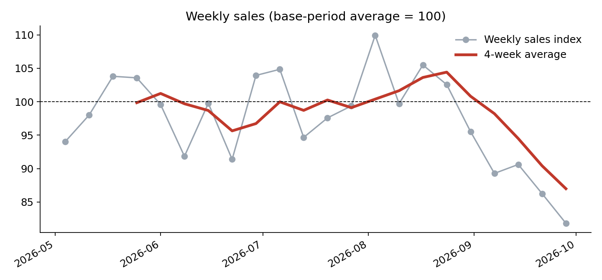
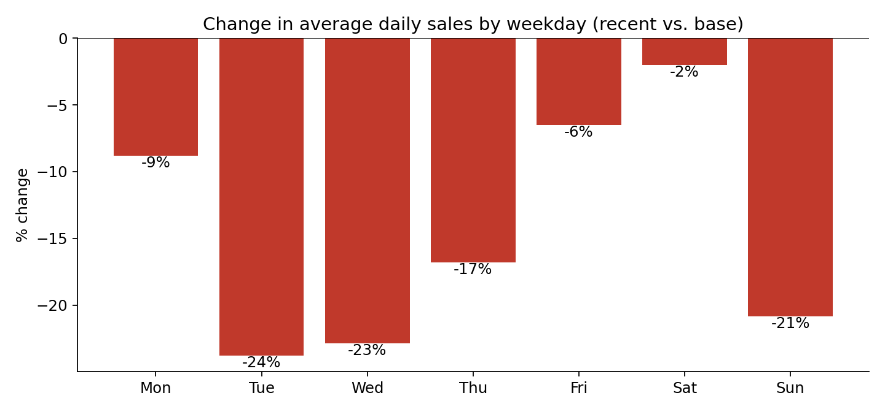
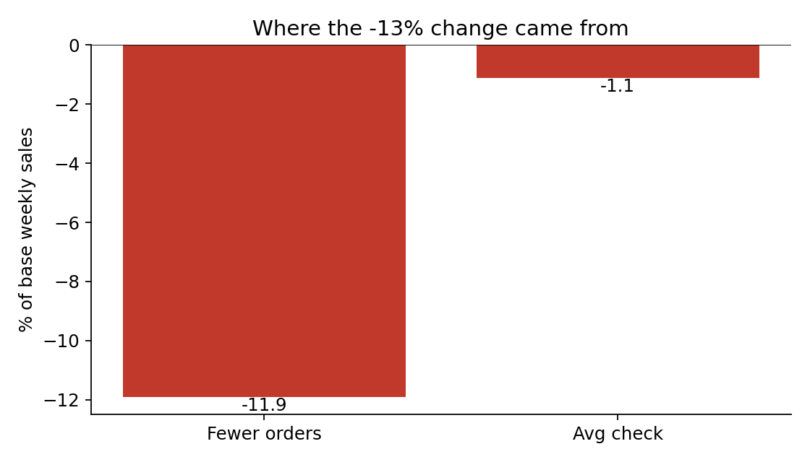

# Restaurant Sales Trend Analysis

**Question:** a local restaurant's weekly sales fell in late summer. Was it fewer customers, smaller checks, or both, and where was it concentrated?

> **Privacy note:** the original analysis used a real restaurant's POS exports, which are private and are **not** in this repository. Everything here runs on **synthetic sample data** (invented numbers in the same format as a POS "Sales by day" export, with a weeknight slowdown deliberately built in so the method has something to find). Outputs are percentages and indexed charts only, with no dollar amounts. Results on the real dataset can be discussed in interviews.

## Method

1. **Clean:** load daily net sales, orders and guests; drop incomplete days; keep only full Monday-Sunday weeks so day-of-week mix doesn't distort comparisons.
2. **Compare two periods:** a *base* period (17 weeks, May-Aug) vs. a *recent* period (last 4 full weeks).
3. **Decompose.** Since `Sales = Orders x Average check`:
   - Traffic effect = (recent orders - base orders) x base average check
   - Check effect = recent orders x (recent average check - base average check)
   - The two sum exactly to the total change, so the split is complete, not approximate.
4. **Drill down:** day of week, then (in the Excel model) a scenario for winning back part of the lost sales.

## Results on the sample data

| Metric (recent vs. base) | Change |
|---|---|
| Weekly net sales | -13.0% |
| Orders per week | -11.9% |
| Average check | -1.3% |
| Effect of fewer orders (% of base sales) | -11.9 pts |
| Effect of check size (% of base sales) | -1.1 pts |





On this synthetic data, nearly all of the decline comes from fewer orders, and it is concentrated Tuesday, Wednesday and Sunday. These numbers are produced by the generator, so they demonstrate the method, not a real business.

## Excel model

`examples/Sample_Financial_Model.xlsx` is built from the same synthetic data with live formulas (weekly rollups, decomposition, weekday table, a recovery scenario and a monthly profit estimate). Blue cells are inputs, yellow cells are assumptions to edit. **Cost inputs are placeholders**, so profit figures are illustrative only.

## Run it

```bash
pip install -r requirements.txt
python src/generate_sample_data.py     # writes sample_data/Sales by day.csv
python src/analyze.py                  # prints results, writes charts + docs/summary.csv
python src/build_excel.py              # writes examples/Sample_Financial_Model.xlsx
```

To use your own export: `python src/analyze.py --input "path/Sales by day.csv" --end YYYY-MM-DD` (columns: `yyyyMMdd, Net sales, Total orders, Total guests`).

## Limitations

- Only about 5 months of data, so **seasonality can't be separated from a real decline** without prior-year figures.
- Observational: the analysis shows *where* sales fell, not *why*. Any fix (e.g., a weeknight promotion) would need a test with a comparison group.
- Two-period averages are sensitive to which weeks are chosen; both periods are configurable.
